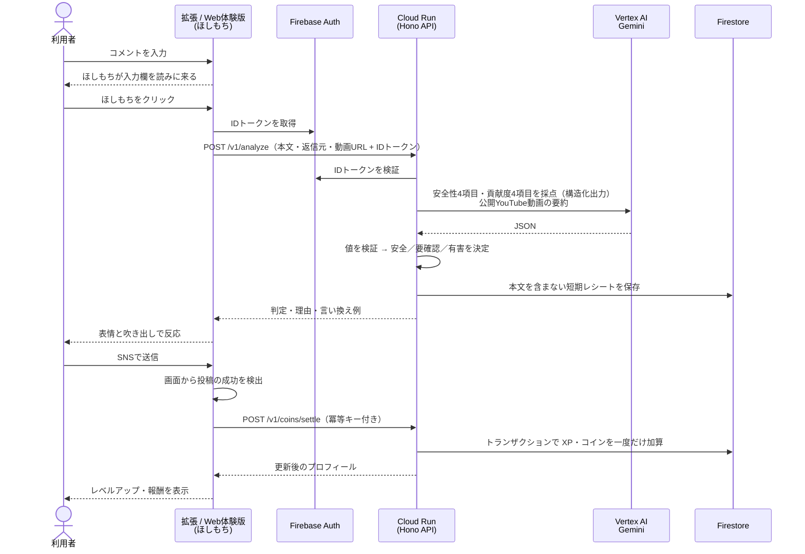

# Commet ✦ ことばと、いっしょに育つ。

X のポストや YouTube のコメントを **送信する前に** 見直すための Chrome 拡張です。入力欄のそばでキャラクターの「ほしもち」が文章を読み、クリックすると Gemini が「安全性」と「対話への貢献」を分析します。判定の理由や言い換え例、ほしもちの表情を見て、相手にどう伝わるかを確かめられます。投稿が成功すると、ことば選びに応じてほしもちが育ちます。

> **DevFest GDGoC Japan 2026 Hackathon 提出作品**　チーム：Poetomi（竹下理斗・森澤諒星）


## 🚀 デプロイ URL（Web 体験版）

**https://commet-api-561617243505.asia-northeast1.run.app/**

- 拡張機能をインストールせずに、ブラウザでそのまま試せます
- サンプル判定・育成・着せ替え・ガチャは **ログイン不要** です
- Google ログインすると **Gemini 判定** に切り替えられます

---

## 目次

- [解決したい課題](#解決したい課題)
- [主な機能とスクリーンショット](#主な機能とスクリーンショット)
- [使い方](#使い方)
- [アーキテクチャ](#アーキテクチャ)
- [使用技術](#使用技術)
- [ファイル構成](#ファイル構成)
- [ローカルで動かす](#ローカルで動かす)
- [テスト](#テスト)
- [仕様の詳細・関連資料](#仕様の詳細関連資料)

## 解決したい課題

2024年12月に弁護士ドットコムが一般会員 1,329 人に行った調査では、誹謗中傷をしたことがあると答えた人の **52.7% が「投稿したときは誹謗中傷だと思っていなかった」** と回答しています。この結果から、送信する前に「相手にどう伝わるか」に気づける機会が必要だと考えました。

| 観点           | よくある投稿確認・通報               | Commet のアプローチ                                    |
| -------------- | ------------------------------------ | ------------------------------------------------------ |
| 使う場面       | 自分で見直す／問題が起きてから通報する | SNS の入力欄のそばで、**送信する前に** 振り返る        |
| 文脈の扱い     | 投稿する人が自分で背景を整理する     | 返信元のポストや **YouTube 動画の要約** も含めて分析する |
| 続けるきっかけ | 見直す動機を自分で保つ               | 表情・育成・着せ替え・ガチャを、続けるきっかけにする   |

投稿するかどうかは、最後まで利用者が決めます。Commet は投稿を止めたり削除したりしません。

## 主な機能とスクリーンショット

### 1. 入力欄のそばで、ほしもちが文章を読む

コメントを書き始めると、ほしもちが入力欄のそばへ歩いてきます。欄のほうへ身を乗り出し、目線・うなずき・まばたきで文章を読むしぐさをします。


### 2. クリックすると投稿前チェック（Gemini 判定）

ほしもちをクリックすると判定が始まります。Gemini が **安全性 4 項目**（人格攻撃・差別・脅迫や暴力・嫌がらせ）と **貢献度 4 項目**（感謝や応援・建設的な議論・質問や情報提供・ユーモア）を採点し、サーバーが「安全／要確認／有害」を決めます。人を傷つける可能性が高い表現には、理由と言い換え例を表示します。

| 傷つける表現：ほしもちが悲しみ、言い換え例を表示 | Gemini 判定：思いやりのある投稿 |
| :---: | :---: |
|  |  |

### 3. 投稿が成功すると育つ

送信が成功したことを SNS の画面から確認できたときだけ、XP とコインを確定します。ことばの傾向に応じて「ぬくもり・ひらめき・おちゃめ」の 3 つの能力が伸びます。

| 育成状況 | スマートフォン表示 |
| :---: | :---: |
|  |  |

### 4. 着せ替え・ガチャ・今日のかけら交換

コインでガチャを引き、手に入れたアイテムでほしもちを着せ替えられます。同じアイテムが重なると「星のかけら」になり、日替わりの交換に使えます。

| 着せ替え | ガチャ・今日のかけら交換 |
| :---: | :---: |
|  |  |

## 使い方

### Web 体験版（おすすめ・インストール不要）

[デプロイ URL](https://commet-api-561617243505.asia-northeast1.run.app/) を開きます。YouTube 風・X 風の画面に、拡張版と同じ UI（`Overlay`）を Shadow DOM で重ねています。キャラの移動、入力欄の検出、判定、送信成功の検出、育成、着せ替え、ガチャには、拡張版と同じ UI と処理を使っています。

1. 画面上部で **「YouTube」** か **「X」** を選び、コメント欄・返信欄に文章を入力します（「例文を入力」からも選べます）。
2. ほしもちが入力欄を読みに来ます。**ほしもちをクリック** すると判定し、表情と吹き出しで反応します。
3. ほしもちの下にある **三本線のメニュー** から、判定結果・育成状況・着せ替え・ガチャ・設定を開けます。
4. 画面内の「コメント」「返信する」で体験用の投稿をすると、送信成功を検出して育成に反映します。**実際の YouTube・X には送信しません。**
5. 「判定方法」を「Gemini」にするには、「ログイン」から Google アカウントでログインします。YouTube の公開動画の URL を指定すると、動画の要約も判定に使います。

- サンプル判定はログイン不要の簡易ルールで、Gemini とは通信しません（画面に「AI未使用」と表示します）。
- 体験データ（育成・所持品・ガチャ）は、このブラウザの `localStorage` だけに保存します。コイン 30 枚・星のかけら 20 個から始まります。判定した本文は保存しません。

### Chrome 拡張版（実際の X・YouTube で使う）

Chrome ウェブストアには未公開のため、ソースからビルドして読み込みます（手順は [ローカルで動かす](#ローカルで動かす)）。

1. `chrome://extensions` でデベロッパーモードをオンにし、「パッケージ化されていない拡張機能を読み込む」で `.output/chrome-mv3` を選びます。
2. Commet のポップアップからログインします。
3. X・YouTube のタブを再読み込みすると、ほしもちが表示されます。使い方は Web 体験版と同じです。
   - ほしもちはドラッグで好きな位置に動かせます。
   - 動画を見ている間は「仮コイン」がたまり、投稿が成功すると判定に応じた倍率で確定します。

## アーキテクチャ


アイコン出典：[Google Cloud 公式](https://cloud.google.com/icons) / [Firebase 公式](https://firebase.google.com/brand-guidelines)

- **Cloud Run** 1 つのサービスで、Web 体験版の静的ファイルと Node.js + Hono の API の両方を配信します。
- **Gemini（Vertex AI 経由）** は Cloud Run からだけ呼び出します。API キーや認証情報は拡張機能やブラウザに配りません。
- AI の出力はサーバーで値を検証し、XP・コインの計算は決まったゲームルールで行います（AI に報酬量を決めさせません）。
- コメント本文や返信元の本文は **Firestore にもログにも保存しません**。精算に必要な数値とフラグだけを短期間保持します。

### 投稿前チェックから育成までの流れ



### API エンドポイント

| メソッド・パス                   | 内容                                         |
| -------------------------------- | -------------------------------------------- |
| `GET /health`                    | ヘルスチェック                               |
| `POST /v1/analyze`               | 投稿前チェック（Gemini 判定・動画要約）      |
| `GET /v1/profile`                | 育成状況・所持品・コインの取得               |
| `POST /v1/coins/tick`            | 閲覧中の仮コインの加算                       |
| `POST /v1/coins/prepare`・`settle` | 投稿成功後の XP・コインの精算（冪等）        |
| `POST /v1/gacha/draw`            | ガチャ                                       |
| `GET /v1/gacha/exchange-shop`    | 今日のかけら交換の候補                       |
| `POST /v1/gacha/exchange`        | かけら交換                                   |
| `POST /web-demo/analyze`         | Web 体験版の Gemini 判定（ログイン必須）     |
| `GET /`                          | Web 体験版                                   |

`/v1/*` は Firebase の ID トークンで認証します。Gemini の呼び出しには、ユーザーごと・プロジェクト全体の 1 日あたりの上限を設けています。

## 使用技術

| 分類           | 技術                                                                                     |
| -------------- | ---------------------------------------------------------------------------------------- |
| フロントエンド | TypeScript, React 19, [WXT](https://wxt.dev/)（Chrome 拡張 MV3）, Shadow DOM             |
| バックエンド   | Node.js 22, [Hono](https://hono.dev/), Zod                                               |
| AI             | Gemini（`gemini-3.5-flash-lite`）, Vertex AI                                             |
| Google Cloud   | Cloud Run, Cloud Build / Artifact Registry, Cloud Logging                                |
| Firebase       | Firebase Authentication（Google ログイン）, Cloud Firestore                              |
| テスト・品質   | Vitest, Playwright, Firebase Emulator, ESLint, Prettier                                  |

## ファイル構成

```text
.
├── extension/                # Chrome拡張（React + WXT）
│   ├── entrypoints/          #   content script・background・popup・options
│   ├── core/                 #   Firebaseログイン、APIクライアント、精算の再送
│   ├── sns/                  #   X・YouTube別のセレクタ、文脈取得、投稿成功の検出、キャラ移動
│   ├── ui/                   #   ほしもち・メニュー・着せ替え・ガチャなどのReact UI
│   └── assets/fonts/         #   UIフォント
├── web/                      # Web体験版（YouTube風・X風の画面に拡張のUIを重ねる）
├── server/                   # API（Node.js + Hono）
│   ├── app.ts                #   ルーティング、認証ミドルウェア、入力検証
│   ├── web.ts / web-demo.ts  #   Web体験版の配信と、体験版用のGemini判定
│   ├── service/              #   AI判定・動画文脈、成長、コイン精算、ガチャ
│   ├── repository/           #   Gemini HTTP通信、Firestoreトランザクション、日次上限
│   └── model/
├── shared/                   # フロント・API共通のZodスキーマ、判定ルール、育成カタログ
├── assets/characters/        # ほしもちの画像素材（STAR-PET.mdに素材の説明）
├── test/                     # Vitest（単体・API・Firestore結合）と Playwright（e2e・web）
├── docs/
│   ├── Gemini_Rewards.md     #   評価・報酬・育成の仕様
│   ├── analysis/             #   Gemini判定の精度検証の記録
│   └── images/               #   README用の画像
├── Dockerfile                # Cloud Run用（Web体験版 + APIを1つのイメージに）
├── firebase.json / firestore.rules
├── wxt.config.ts             # 拡張のビルド設定
├── .env.example              # ローカル開発用の環境変数テンプレート
├── .env.production.example   # 公開用の環境変数テンプレート
│
│   ── 以下はハッカソン前半の初期MVP（参考として残しています）──
├── commet/ requirements*.txt # 初期版のPython API（FastAPI + SQLite）
├── content/ lib/ popup/ options/ background.js manifest.json  # 初期版の素のJS拡張
├── demo/                     # APIなしで動く初期版のモック
└── tests/                    # 初期版のテスト
```

## ローカルで動かす

必要なもの：Node.js 22.13 以上、Google Chrome、Java 21（Firebase Emulator 用）

```sh
npm ci
cp .env.example .env
```

### Web 体験版だけを見る

```sh
npm run build:web
npm run preview:web   # http://127.0.0.1:8888
```

プレビューはサンプル判定用です。Gemini 判定には実際の API と認証の設定が必要です。

### 拡張版 + API（Firebase Emulator）

ターミナルを分けて、それぞれ実行します。

```sh
npm run emulators   # Firebase Auth / Firestore のエミュレーター
npm run dev:api     # Hono API（http://127.0.0.1:8765）
```

```sh
npm run build       # 拡張を .output/chrome-mv3 に出力
```

Chrome で `.output/chrome-mv3` を読み込み、ポップアップの「開発用ログイン」を押します。

### Gemini の設定（`.env`）

| 使い方                        | 設定                                                                                                                        |
| ----------------------------- | --------------------------------------------------------------------------------------------------------------------------- |
| Vertex AI                     | `GEMINI_PROVIDER=vertex`, `GOOGLE_CLOUD_PROJECT=<実プロジェクト>`, `GOOGLE_CLOUD_LOCATION=global`, `gcloud auth application-default login` |
| Gemini Developer API          | `GEMINI_PROVIDER=developer`, `GEMINI_API_KEY=<キー>`                                                                        |
| 実 API を使わない（開発用）   | `GEMINI_PROVIDER=developer`, `COMMET_DEMO_AI=true`（キーは空のまま）                                                        |

モデルは `GEMINI_MODEL` で変えられます（既定は `gemini-3.5-flash-lite`）。動画の要約を取得できないときは、タイトルと説明文を使って判定します。

> [!IMPORTANT]
> Gemini の API キーや Firebase Admin の認証情報はサーバー側だけで管理します。`WXT_` で始まる環境変数は拡張のビルドに埋め込まれるため、秘密情報を入れないでください。`.env` や `.env.*.local` はコミットしません。

### Cloud Run へのデプロイ

`Dockerfile` で、Web 体験版（`npm run build:web`）と API（`npm run build:api`）を 1 つのイメージにまとめます。Firebase Web アプリの公開設定（`WXT_FIREBASE_API_KEY / PROJECT_ID / AUTH_DOMAIN / APP_ID`）はビルド引数で渡します。実行時には `HOST=0.0.0.0` と `PORT` を使い、Gemini は Cloud Run のサービスアカウントから Vertex AI 経由で呼び出します（API キーは不要です）。公開用の値は `.env.production.example` を参照してください。

## テスト

```sh
npm run typecheck
npm run lint
npm test                    # Vitest
npm run test:firebase       # Firestore・Auth の結合テスト（Emulator）
npx playwright install chromium
npm run test:e2e            # 拡張の e2e（テスト用の X 画面）
npm run test:web            # Web 体験版のブラウザテスト
```

Playwright のテスト中は、ローカルの 8765・9099 番ポートを空けておいてください。

## 仕様の詳細・関連資料

### 利用量の上限

- Hono API：UID あたり 90 回／分
- Gemini：1 日あたり UID ごとに 20 回、プロジェクト全体で 150 回（日本時間で日付が変わるとリセット。動画要約も含む）。`COMMET_GEMINI_USER_DAILY`・`COMMET_GEMINI_PROJECT_DAILY` で変更できます
- 同じ投稿のチェックは短時間キャッシュし、動画要約はサーバーのメモリに最長 7 日間・20 件まで再利用します。閲覧中や入力中のアニメーションでは Gemini を呼び出しません

### 報酬と育成

- 仮コイン：有効な閲覧 15 秒につき 1 枚、1 日 60 枚まで
- 投稿成功時の倍率：安全で貢献度 0 → 1.0 倍、安全で貢献度 1〜2 → 1.5 倍、有害 → 0 倍、要確認 → 暫定 1.0 倍
- ガチャは確定コイン 10 枚で 1 回。重複したアイテムは星のかけら（N 1 個・R 3 個・SR 5 個・UR 8 個）になります
- 今日のかけら交換：未所持のアイテムから最大 6 点を日替わりで表示します

詳しくは [Gemini による評価・報酬・育成](docs/Gemini_Rewards.md) を参照してください。

### 関連資料

- [評価・報酬・育成の仕様](docs/Gemini_Rewards.md)
- [Gemini 判定の精度検証](docs/analysis/README.md)
- [ほしもちの素材と生成プロンプト](assets/characters/STAR-PET.md)
- [プライバシー概要](PRIVACY.md)
- [要件の経緯](REQUIREMENTS.md)・[初期の公開版構成案（旧称 KokoroPet）](ARCHITECTURE.md)

## ライセンス

[MIT License](LICENSE)
